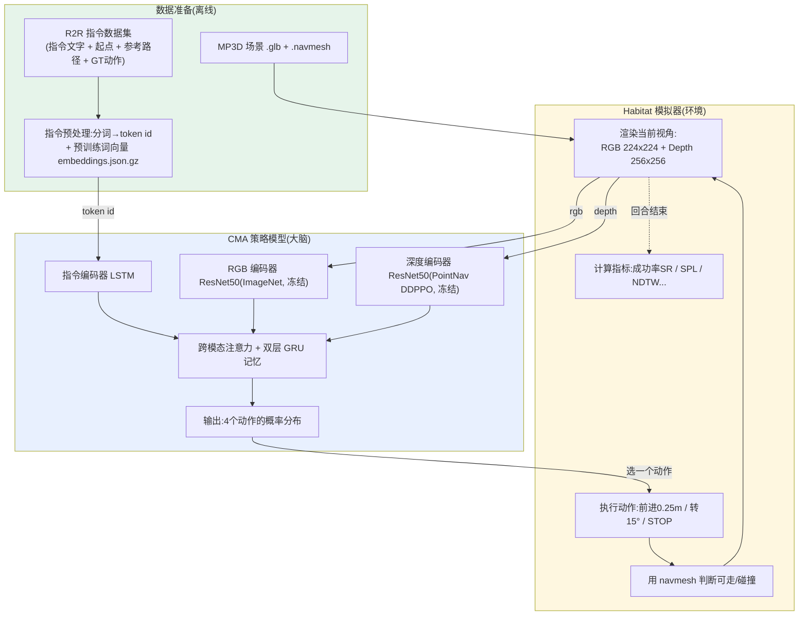
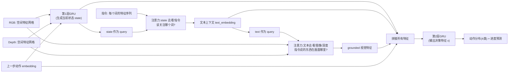

# VLN-CE 工作原理与 Pipeline 详解

> 面向初次接触者的通俗、详细讲解。VLN-CE = **V**ision-and-**L**anguage **N**avigation in **C**ontinuous **E**nvironments(连续环境中的视觉语言导航)。
>
> 一句话概括:**给机器人一句自然语言指令(如"走过客厅到早餐吧"),它只靠"眼睛看到的画面"和"这句话",一步一步(前进 0.25 米 / 转 15 度)在 3D 房屋里走到目标点并停下。**

---

## 目录
1. [任务是什么](#1-任务是什么)
2. [整体 Pipeline 流程图](#2-整体-pipeline-流程图)
3. [一次"决策循环"到底发生了什么](#3-一次决策循环到底发生了什么)
4. [输入(智能体能感知到什么)](#4-输入智能体能感知到什么)
5. [模型详解:CMA(输入 → 结构 → 输出)](#5-模型详解cma输入--结构--输出)
6. [视频里的自然语言提示词在哪里起作用](#6-视频里的自然语言提示词在哪里起作用)
7. [有地图吗?到底是怎么导航的](#7-有地图吗到底是怎么导航的)
8. [训练:用的就是这个数据集吗?怎么训练](#8-训练用的就是这个数据集吗怎么训练)
9. [代码指向速查表](#9-代码指向速查表)
10. [关键配置速查](#10-关键配置速查)
11. [现有模型清单 + ABot-N1 替换对照表](#11-现有模型清单--abot-n1-替换对照表)

---

## 1. 任务是什么

- **场景**:用 Matterport3D(MP3D)扫描的真实房屋 3D 重建网格(`.glb`),共 90 个场景。
- **智能体(agent)**:一个可以在房屋里移动的相机,带 RGB 摄像头和深度摄像头。
- **给它的任务**:一句人类写的英文导航指令 + 一个起点。
- **它要做的**:根据指令走到目标位置,并在目标附近**主动执行 STOP**。
- **成功判定**:执行 STOP 时,离目标点 ≤ 3.0 米算成功(`SUCCESS_DISTANCE: 3.0`)。

与传统 VLN(在离散的"导航图"节点间跳转)不同,**"CE / 连续环境"**意味着智能体只能用**低级动作**一点点挪动,没有"传送到下一个路点"这种捷径 —— 更接近真实机器人。

**动作空间(只有 4 个离散动作)** —— 见 `habitat_extensions/config/vlnce_task.yaml`:

| 动作 | 效果 |
|------|------|
| `STOP` | 停下,结束本回合(用来宣告"我到了") |
| `MOVE_FORWARD` | 前进 `0.25` 米 |
| `TURN_LEFT` | 左转 `15°` |
| `TURN_RIGHT` | 右转 `15°` |

```12:19:habitat_extensions/config/vlnce_task.yaml
SIMULATOR:
  ACTION_SPACE_CONFIG: v0
  AGENT_0:
    SENSORS: [RGB_SENSOR, DEPTH_SENSOR]
  FORWARD_STEP_SIZE: 0.25
  TURN_ANGLE: 15
```

每回合最多走 `MAX_EPISODE_STEPS: 500` 步。

---

## 2. 整体 Pipeline 流程图



核心是右边这个**闭环(closed-loop)**:模型看一眼画面 → 出一个动作 → 模拟器移动智能体 → 产生新画面 → 再看再动……直到 STOP。

---

## 3. 一次"决策循环"到底发生了什么

评估/推理时,每一步(timestep)的代码主循环在 `vlnce_baselines/common/base_il_trainer.py` 的 `_eval_checkpoint()` 里:

```321:335:vlnce_baselines/common/base_il_trainer.py
        while envs.num_envs > 0 and len(stats_episodes) < num_eps:
            current_episodes = envs.current_episodes()

            with torch.no_grad():
                actions, rnn_states = self.policy.act(
                    batch,
                    rnn_states,
                    prev_actions,
                    not_done_masks,
                    deterministic=not config.EVAL.SAMPLE,
                )
                prev_actions.copy_(actions)

            outputs = envs.step([a[0].item() for a in actions])
```

逐句读:
1. `envs.current_episodes()`:拿到当前回合信息(含指令)。
2. `self.policy.act(batch, ...)`:把当前观测 `batch`(RGB/Depth/指令/上一步动作/记忆)喂给模型,得到**这一步要执行的动作** + 更新后的 RNN 记忆 `rnn_states`。
3. `envs.step([action])`:模拟器**真正执行**这个动作,智能体前进/转向,返回**新的观测**。
4. 循环回到第 1 步。若动作是 `STOP` 或步数到 500,本回合结束,计算指标。

> 关键点:模型是**有记忆的**(RNN/GRU)。它不是每帧独立判断,而是记着"我之前走过哪、指令走到哪了",所以 `rnn_states` 会一直传递。

---

## 4. 输入(智能体能感知到什么)

智能体每一步的"观测(observation)"是一个字典,由 Habitat 的**传感器(Sensor)**产生。VLN-CE 关键传感器:

| 观测键 | 含义 | 尺寸 | 来源 |
|--------|------|------|------|
| `rgb` | 第一人称彩色画面 | `224×224×3` | `RGB_SENSOR` |
| `depth` | 第一人称深度图 | `256×256×1` | `DEPTH_SENSOR` |
| `instruction` | 指令的**词 id 序列** | `[seq_len]` | `INSTRUCTION_SENSOR` |
| `progress` | (训练辅助)当前已完成指令的比例 0~1 | 标量 | `VLNOracleProgressSensor` |
| `shortest_path_sensor` | (仅训练)老师给的"下一步最优动作" | 标量 | `ShortestPathSensor` |

- 传感器实现见 `habitat_extensions/sensors.py`。
- 其中"老师动作"传感器(训练时用来模仿):

```125:153:habitat_extensions/sensors.py
@registry.register_sensor
class ShortestPathSensor(Sensor):
    """Provides the next action to follow the shortest path to the goal."""

    cls_uuid: str = "shortest_path_sensor"
    ...
    def get_observation(self, *args: Any, episode, **kwargs: Any):
        best_action = self.follower.get_next_action(episode.goals[0].position)
        if best_action is None:
            best_action = HabitatSimActions.STOP
        return np.array([best_action])
```

> 注意:`shortest_path_sensor`(老师)和 `progress`(进度)**只在训练时使用**,评估时智能体拿不到这些"作弊信息",只有 RGB、Depth、instruction。

---

## 5. 模型详解:CMA(输入 → 结构 → 输出)

论文里的 baseline 叫 **CMA = Cross-Modal Attention(跨模态注意力)**。代码:`vlnce_baselines/models/cma_policy.py`,网络类 `CMANet`。

### 5.1 输入 / 输出一览

**输入**(`CMANet.forward`,`cma_policy.py:219`):
- `observations["instruction"]`:指令 token id 序列
- `observations["rgb"]`:`[B,224,224,3]`
- `observations["depth"]`:`[B,256,256,1]`
- `prev_actions`:上一步动作(整数)
- `rnn_states`:上一步的记忆(隐藏状态)
- `masks`:是否是新回合(用于重置记忆)

**输出**:
- 一个特征向量 `x` → 交给 `CategoricalNet` 得到 **4 个动作上的概率分布**(`vlnce_baselines/models/policy.py:19`)
- `act()` 里根据分布**采样**或取**最大概率**(评估时 `deterministic=True` 取 argmax)得到最终动作。
- 另外还有一个**进度预测头** `progress_monitor`(预测"指令完成了百分之几",只在训练当辅助损失)。

整个模型 **3685 万参数,其中可训练 615 万**(三个编码器都是冻结的预训练权重),日志里能看到:
`Agent parameters: 36856021. Trainable: 6153381`。

### 5.2 三个"编码器":把不同模态变成向量

| 模态 | 编码器 | 是否训练 | 预训练来源 | 代码 |
|------|--------|----------|-----------|------|
| 语言指令 | `InstructionEncoder`(LSTM) | 词向量冻结,LSTM 训练 | GloVe 风格 50 维词向量 | `models/encoders/instruction_encoder.py` |
| RGB 图像 | `TorchVisionResNet50` | **冻结** | ImageNet | `models/encoders/resnet_encoders.py:118` |
| 深度图 | `VlnResnetDepthEncoder`(ResNet50) | **冻结** | PointGoal 导航 DDPPO(`gibson-2plus-resnet50.pth`) | `models/encoders/resnet_encoders.py:17` |

- **指令编码器**:每个词先查预训练词向量表(vocab 2504,维度 50),再过双向 LSTM,得到**每个词位置的特征**(不是只取最后一个,`final_state_only=False`),供后面注意力"逐词看"。

```63:94:vlnce_baselines/models/encoders/instruction_encoder.py
    def forward(self, observations: Observations) -> Tensor:
        if self.config.sensor_uuid == "instruction":
            instruction = observations["instruction"].long()
            lengths = (instruction != 0.0).long().sum(dim=1)
            instruction = self.embedding_layer(instruction)
        ...
        output, final_state = self.encoder_rnn(packed_seq)
        ...
        return nn.utils.rnn.pad_packed_sequence(output, batch_first=True)[0].permute(0, 2, 1)
```

- **深度编码器**用的正是我们下载的 `data/ddppo-models/gibson-2plus-resnet50.pth`:它是别人在"点目标导航"任务上预训练好的,善于从深度图提取"哪里能走、离墙多远"的几何信息。加载逻辑:

```48:61:vlnce_baselines/models/encoders/resnet_encoders.py
        if checkpoint != "NONE":
            ddppo_weights = torch.load(checkpoint)
            weights_dict = {}
            for k, v in ddppo_weights["state_dict"].items():
                split_layer_name = k.split(".")[2:]
                if split_layer_name[0] != "visual_encoder":
                    continue
                layer_name = ".".join(split_layer_name[1:])
                weights_dict[layer_name] = v
            del ddppo_weights
            self.visual_encoder.load_state_dict(weights_dict, strict=True)
```

### 5.3 跨模态注意力 + 双层记忆(CMA 的核心)

`CMANet.forward`(`cma_policy.py:219`)的处理流程:



直白理解这两次注意力(`_attn`,`cma_policy.py:207`):
1. **"我现在该关注指令里的哪个词?"** —— 用当前状态去加权指令的各个词(比如刚出发关注"走出房间",快到了关注"停在沙发旁")。
2. **"这个词说的东西在画面的哪个位置?"** —— 用关注到的文字去加权 RGB/深度的空间特征,把语言和视觉**对齐(grounding)**。

最后把 `[状态, 文本, RGB, 深度, 上一步动作]` 拼起来 → 压缩 → 第 2 层 GRU → 得到决策特征,输出动作分布。

```276:294:vlnce_baselines/models/cma_policy.py
        x = torch.cat(
            [
                state,
                text_embedding,
                rgb_embedding,
                depth_embedding,
                prev_actions,
            ],
            dim=1,
        )
        x = self.second_state_compress(x)
        (
            x,
            rnn_states_out[:, self.state_encoder.num_recurrent_layers :],
        ) = self.second_state_encoder(...)
```

---

## 6. 视频里的自然语言提示词在哪里起作用

你在 demo 视频底部看到的那段英文(如 *"Turn to the left and walk through the living room..."*),它的生命周期:

1. **数据集里就有**:每个 episode 自带 `instruction.instruction_text`(原始英文)和预处理好的 `instruction.tokens`(词 id 序列)。
2. **离线分词**:`R2R_VLNCE_v1-3_preprocessed` 里已经把句子切成词、映射成 id,并配了词向量表 `embeddings.json.gz`(所以我们用 preprocessed 版就能开箱即用)。
3. **运行时进入模型**:
   - `INSTRUCTION_SENSOR` 把 token 序列作为观测 `instruction` 给出;
   - `extract_instruction_tokens()`(`vlnce_baselines/common/utils.py:6`)从观测里取出 `tokens`;
   - `InstructionEncoder` 把 token → 词向量 → LSTM → 指令特征;
   - 在 CMA 里通过**注意力**影响每一步动作。**这就是"提示词起作用"的地方 —— 它是模型每一步决策的 query 依据之一。**
4. **视频里的文字只是"字幕"**:那段文字是可视化时用 `append_text_to_image` 叠上去的,方便你对照,不参与计算。叠字幕代码在 `base_il_trainer.py:346` 附近:

```345:349:vlnce_baselines/common/base_il_trainer.py
                if len(config.VIDEO_OPTION) > 0:
                    frame = observations_to_image(observations[i], infos[i])
                    frame = append_text_to_image(
                        frame, current_episodes[i].instruction.instruction_text
                    )
```

---

## 7. 有地图吗?到底是怎么导航的

**关键结论:智能体本身没有地图,也不做全局路径规划。** 它是"盲走"式的端到端策略 —— 只靠**当前第一人称 RGB + 深度 + 指令 + 自己的 RNN 记忆**,直接输出下一个低级动作。

那"地图数据"体现在哪?分两层,别混淆:

| 谁 | 用到什么"地图/几何" | 说明 |
|----|--------------------|------|
| **模拟器(环境)** | MP3D 的 `.glb` 三维网格 + `.navmesh` 可行走网格 | 用来渲染画面、判断碰撞、算最短路径/指标。这是"世界"的真值。 |
| **智能体(模型)** | ❌ 不给地图 | 只给 RGB/Depth/指令。它对全局布局一无所知,靠"看着走"。 |
| **视频里的俯视图** | 仅用于可视化 | 那张俯视轨迹图(蓝=走过的路,红=参考路径)是我们画给人看的,模型看不到。 |

所以"导航"本质是:**模型看一眼 → 猜一个动作 → 环境用 navmesh 让它移动(撞墙就走不动)→ 看新画面 → 再猜**,循环到它自己决定 STOP。深度图 + PointNav 预训练编码器帮它感知"哪里能走、离障碍多远",这是它不撞墙、能穿门的关键。

> 模拟器加载场景/navmesh 的证据(demo 日志):
> `Loaded navmesh data/scene_datasets/mp3d/17DRP5sb8fy/17DRP5sb8fy.navmesh`

### 7.1 仿真动作是否被准确执行?与真实规控有什么差异?

**是的,该方案隐含了理想动作执行假设。** Habitat-Sim 中的 `MOVE_FORWARD` 和 `TURN_LEFT/RIGHT` 更接近直接修改仿真状态的指令,而不是发送给电机的控制量:

- `MOVE_FORWARD`:准确尝试前进 `0.25 m`;
- `TURN_LEFT/RIGHT`:准确尝试旋转 `15°`;
- 模拟器根据 `.navmesh` 和场景几何处理不可通行位置与碰撞;
- `ALLOW_SLIDING: True` 时,碰撞后可能沿障碍物表面滑动,但这不是人为添加的随机误差;
- 当前配置没有模拟电机误差、地面打滑、惯性、控制延迟、里程计漂移或传感器噪声。

因此,CMA 的执行链路是:

```text
策略输出离散动作
    → Habitat-Sim 按理想运动学和碰撞规则更新位姿
    → 在新位姿渲染 RGB/Depth
    → 策略根据新观测继续决策
```

真实机器人无法保证“前进 `0.25 m`”或“旋转 `15°`”被完全准确地执行。实际位移会受到轮胎打滑、地面不平、机器人动力学、控制与感知延迟、定位误差及机器人模型误差等因素影响。因此,落地时不能把 CMA 动作直接等价为准确位姿变化,而应增加真实规控闭环:

```text
VLN 策略输出局部目标/导航意图
    → 局部路径规划器
    → 底盘控制器发送速度指令
    → 里程计/IMU/视觉反馈实际位姿
    → 根据跟踪误差持续修正
```

CMA 每一步都会读取新画面再决策,具备一定的**高层闭环纠错**能力;但它没有真实机器人需要的**低层运动控制闭环**。这正是从 Habitat 仿真迁移到真实机器人时的重要 **Sim-to-Real gap**。

> **来源** · 2026-10-27 · Habitat 动作与真实规控 · chat: `未找到` · workspace: `notebook`

---

## 8. 训练:用的就是这个数据集吗?怎么训练

**是的**,训练用的就是 R2R_VLNCE 这个数据集(train split 有 10819 个 episode)。每个训练 episode 提供:指令、起点、**参考路径 `reference_path`**、以及**专家动作序列(GT actions)**。训练目标是**模仿学习(Imitation Learning)** —— 让模型学会"在这个画面 + 这句指令下,老师会走哪一步"。

代码里有两种训练器(都继承 `BaseVLNCETrainer`):

### (A) `DaggerTrainer`(`vlnce_baselines/dagger_trainer.py`,默认)
DAgger = Dataset Aggregation。流程:
1. 让当前模型在模拟器里真实地走一遍;
2. **每一步同时记录**:当前观测、上一步动作、以及**老师(最短路径专家)此刻的正确动作**;
3. 用概率 `beta` 决定这一步"听老师的还是听自己的"(`beta = p^data_it`,随迭代衰减到 0,让模型逐渐脱离老师);
4. 把大量 `(观测, 老师动作)` 存进 LMDB 数据库,然后监督训练。

采样时"听老师 vs 听自己"的代码:

```410:421:vlnce_baselines/dagger_trainer.py
                actions, rnn_states = self.policy.act(
                    batch, rnn_states, prev_actions, not_done_masks,
                    deterministic=False,
                )
                actions = torch.where(
                    torch.rand_like(actions, dtype=torch.float) < beta,
                    batch[expert_uuid].long(),
                    actions,
                )
```

### (B) `RecollectTrainer`(`vlnce_baselines/recollect_trainer.py`)
纯 teacher forcing:直接用数据集里现成的**GT 轨迹动作**(`{split}_gt.json.gz` 里的 `actions`)在模拟器里重放并训练,不用最短路径专家、不存盘。

### 损失函数
无论哪种,核心都是**对动作做交叉熵**(让模型的动作分布逼近老师动作),再加上**进度预测的 MSE 辅助损失**。见 `base_il_trainer._update_agent`:

```162:173:vlnce_baselines/common/base_il_trainer.py
        logits = distribution.logits
        logits = logits.view(T, N, -1)

        action_loss = F.cross_entropy(
            logits.permute(0, 2, 1), corrected_actions, reduction="none"
        )
        action_loss = ((weights * action_loss).sum(0) / weights.sum(0)).mean()

        aux_mask = (weights > 0).view(-1)
        aux_loss = AuxLosses.reduce(aux_mask)

        loss = action_loss + aux_loss
```

### 我们用的预训练模型 `CMA_PM_DA_Aug` 名字含义
- **CMA** = 跨模态注意力模型
- **PM** = Progress Monitor(进度监控辅助任务)
- **DA** = DAgger 训练
- **Aug** = 用 EnvDrop 生成的增广数据扩充训练集

这就是 README 里 val_unseen 达到 ~0.27 SPL 的那个 baseline。

---

## 9. 代码指向速查表

| 你想看的东西 | 文件:行 |
|--------------|---------|
| 程序总入口(train/eval/inference 分发) | `run.py:46` |
| 任务/动作/传感器/成功距离等配置 | `habitat_extensions/config/vlnce_task.yaml` |
| 所有默认超参(模型结构、EVAL、IL、DAGGER) | `vlnce_baselines/config/default.py` |
| **模型主体 CMANet(前向传播)** | `vlnce_baselines/models/cma_policy.py:219` |
| 两次跨模态注意力实现 `_attn` | `vlnce_baselines/models/cma_policy.py:207` |
| 指令(语言)编码器 | `vlnce_baselines/models/encoders/instruction_encoder.py` |
| RGB / 深度 编码器 | `vlnce_baselines/models/encoders/resnet_encoders.py` |
| 策略 `act()`:特征 → 动作分布 → 选动作 | `vlnce_baselines/models/policy.py:26` |
| 传感器(指令、进度、最短路径专家) | `habitat_extensions/sensors.py` |
| 评估主循环(每步决策) | `vlnce_baselines/common/base_il_trainer.py:321` |
| 训练损失(交叉熵 + 辅助) | `vlnce_baselines/common/base_il_trainer.py:137` |
| DAgger 训练器(数据采集 + 训练) | `vlnce_baselines/dagger_trainer.py` |
| Teacher-forcing 训练器 | `vlnce_baselines/recollect_trainer.py` |
| 从观测里取指令 token | `vlnce_baselines/common/utils.py:6` |
| 视频每帧图像合成 / 叠字幕 | `habitat_extensions/utils.py:27` |
| 俯视轨迹地图度量(仅可视化) | `habitat_extensions/measures.py:318` |

---

## 10. 关键配置速查

| 项 | 值 | 位置 |
|----|----|------|
| 前进步长 | 0.25 m | `vlnce_task.yaml` `FORWARD_STEP_SIZE` |
| 转向角度 | 15° | `vlnce_task.yaml` `TURN_ANGLE` |
| 成功距离 | 3.0 m | `vlnce_task.yaml` `SUCCESS.SUCCESS_DISTANCE` |
| 每回合最大步数 | 500 | `vlnce_task.yaml` `MAX_EPISODE_STEPS` |
| RGB 分辨率 | 224×224 | `vlnce_task.yaml` `RGB_SENSOR` |
| 深度分辨率 | 256×256 | `vlnce_task.yaml` `DEPTH_SENSOR` |
| 指令词表大小 / 词向量维度 | 2504 / 50 | `default.py` `INSTRUCTION_ENCODER` |
| GRU 隐藏维度 | 512 | `default.py` `STATE_ENCODER.hidden_size` |
| 深度编码器预训练权重 | `data/ddppo-models/gibson-2plus-resnet50.pth` | `default.py:250` |
| 评价指标 | TL / NE / OS / SR / SPL / NDTW | `vlnce_task.yaml` `MEASUREMENTS` |

**指标含义**:`SR`=成功率;`SPL`=按路径长度加权的成功率(又快又准才高);`NE`=停下时离目标的距离;`NDTW`=走的轨迹和参考路径的贴合度;`OS`=Oracle 成功率(路上是否曾经过目标附近)。

---

## 11. 现有模型清单 + ABot-N1 替换对照表

> 本章把「VLN-CE 当前代码库里到底有哪些模型」列清楚,再对照 ABot-N1(论文 `2607.10383v2`)的方案,说明**哪些模块可以被替换、替换后带来什么**。方便日后做技术选型和改造时查阅。

### 11.1 现有模型清单(VLN-CE 代码库里"真实存在"的模型)

VLN-CE 不是一个单一大模型,而是若干**小模块**拼起来的 CMA(Cross-Modal Attention)策略网络。逐个列出:

| # | 模型/模块 | 作用 | 结构 | 参数规模 | 代码位置 |
|---|-----------|------|------|----------|----------|
| 1 | **指令编码器** InstructionEncoder | 把自然语言指令编码成语义向量 | Embedding(50维) + 单层 LSTM(512) | 小(~百万级) | `models/encoders/instruction_encoder.py` |
| 2 | **深度编码器** VlnResnetDepthEncoder | 把深度图编码成几何特征 | ResNet50,权重来自 DDPPO 点目标导航预训练,**冻结** | ~2400 万(冻结) | `models/encoders/resnet_encoders.py` |
| 3 | **RGB 编码器** TorchVisionResNet | 把彩色图编码成视觉特征 | ImageNet 预训练 ResNet50,**冻结** | ~2400 万(冻结) | `models/encoders/resnet_encoders.py` |
| 4 | **跨模态注意力** CMA 核心 | 让"语言"和"视觉/深度"对齐:看指令该关注画面哪里 | 两路 Attention + 两个 GRU 状态编码器 | 中(~千万级) | `models/cma_policy.py` |
| 5 | **动作头** linear + Categorical | 输出 4 个离散动作的概率 | 一层线性 + softmax | 极小 | `models/cma_policy.py` |
| 6 | **进度监控头(可选)** progress_monitor | 辅助任务:预测"任务完成了百分之几" | 一层线性 | 极小 | `models/cma_policy.py` |

**关键特征**:
- 视觉/深度编码器是**冻结的预训练 ResNet**,不参与 VLN 训练(只当特征提取器)。
- 真正在 VLN 数据上训练的是:指令 LSTM、跨模态注意力、GRU、动作头。
- **没有大语言模型(LLM)、没有显式推理(CoT)、没有世界模型**。指令只是被 LSTM 压成一个向量,模型并不"读懂"指令,只是学到"这种向量 + 这种画面 → 该往哪走"的统计映射。
  - **CoT(Chain-of-Thought,思维链)**:让模型在给出最终答案前,先用自然语言把中间推理步骤一步步"说出来"(例如"门在左前方→先左转→再直行"),再据此决策。好处是更准、可解释;VLN-CE 的 CMA **没有**这一步,ABot-N1 的慢系统才有。
- 训练方式:**模仿学习(DAgger + Teacher Forcing)**,逐动作对齐专家最短路径(见第 8 章)。

### 11.2 ABot-N1 是什么(一句话)

> **术语速查(下列名词在本文首次出现,先解释再阅读):**
> - **快慢双系统(Fast/Slow)**:借鉴人脑"慢思考+快反应"。**慢系统**低频运行、负责"想清楚去哪";**快系统**高频运行、负责"怎么走过去、别撞"。二者解耦,各司其职。
> - **像素目标(Pixel Goal)**:不用坐标/地图,而是**直接在当前摄像头画面上标一个 2D 像素点**当作"下一步该走向的地方"。任何任务都能统一成"画面上标点",接口简单、天然对齐视觉。
> - **CoT(思维链)**:模型先用自然语言把中间推理一步步说出来,再决策(见 11.1 注解)。
> - **GRPO(Group Relative Policy Optimization,群组相对策略优化)**:一种**不需要价值网络**的强化学习算法——对同一输入采样一组候选输出,用奖励打分,鼓励"比同组平均更好"的候选、抑制更差的。
> - **下游导航奖励对齐**:训练信号不再是"每一步动作是否复刻专家(token/动作对齐)",而是"整个方案在真实环境里**能否安全、合规、快速到达**"。ABot-N1 的奖励 = 格式奖励 + 目标对齐奖励 + 安全余量奖励。
> - **正迁移(Positive Transfer)**:多任务一起训练时任务之间**互相促进、共同变强**(反面是互相拖后腿的"负迁移")。ABot-N1 靠统一像素目标接口实现,如 POI 任务只训慢系统却"白嫖"了其他任务能力,成功率 +35%。

ABot-N1 是一个**"快慢双系统"通用导航基座模型**:
- **慢系统(Slow / 认知)**:一个视觉语言模型(VLM),读图 + 读指令,做 **CoT 推理**,输出**像素目标**(在画面上标出"该往哪个像素点走"的 2D 锚点)。低频运行(想清楚"去哪")。
- **快系统(Fast / 控制)**:一个轻量策略,把像素目标翻译成**连续的低级动作**,高频运行(负责"怎么走过去、别撞")。
- **统一像素目标接口**:点目标、指令导航、找物体、找 POI、跟随人 —— 五类任务全部转成同一种"像素目标"表示,从而共享模型、产生**正迁移**。
- **训练**:大规模模仿预训练 + **GRPO 强化学习后训练**(用下游导航奖励对齐,而非只对齐 token/动作)。

### 11.3 替换对照表(现有模块 → ABot-N1 对应方案)

| VLN-CE 现有模块 | ABot-N1 对应/替换 | 替换后带来什么 |
|------------------|--------------------|----------------|
| 指令编码器(LSTM 压成向量) | 慢系统 **VLM** 直接读指令原文 + 图像 | 真正"理解"指令语义、能处理长/复杂/歧义指令,而非统计映射 |
| RGB/深度编码器(冻结 ResNet) | VLM 自带的视觉主干(端到端) | 视觉表征与推理联合优化,不再是"死"的特征 |
| 跨模态注意力 CMA | 慢系统的 **CoT 推理** + 像素目标输出 | 决策可解释(能说出"为什么去那")、可泛化到新任务 |
| 动作头(4 个离散动作) | 快系统输出**连续低级动作** | 动作更平滑、更贴近真实机器人,不受"前进0.25m/转15°"离散栅格限制 |
| 无(缺推理) | 慢系统 **CoT** | 具备中间推理能力 |
| 无(缺 RL) | **GRPO** 后训练 | 用"是否安全到达"的下游奖励对齐,而非只复刻专家动作 |
| 单任务(仅 R2R 指令导航) | **统一像素目标接口**多任务 | 一套模型干五类导航任务,任务间**正迁移**互相增强 |

### 11.4 分层替换建议(由易到难)

不必一步换成完整 ABot-N1,可按成本/收益分阶段:

1. **最小改动**:保留 CMA 框架,把冻结 ResNet 换成更强的开源视觉编码器 → 提升感知,风险最低。
2. **中等改动**:用一个 VLM 替换"指令编码器 + 跨模态注意力",让模型真正读懂指令并输出像素目标(慢系统),快系统仍用轻量控制器 → 获得推理与泛化能力。
3. **大改**:引入统一像素目标接口做多任务训练 + GRPO 后训练 → 得到通用导航基座,享受跨任务正迁移和下游奖励对齐。

> 说明:VLN-CE 的仿真器(Habitat)、R2R 数据、评价指标(SR/SPL/NDTW 等)在任何阶段都可继续复用,替换的只是"策略模型"部分。

---

### 附:亲手跑一遍(本机已部署)
```bash
conda activate vlnce
cd /data/maoli/git/VLN-CE
rm -f data/checkpoints/pretrained/evals_demo/*.json   # demo 结果会防重复,先清掉
python run.py --exp-config vlnce_baselines/config/r2r_baselines/cma_pm_da_aug_eval_demo.yaml --run-type eval
# 视频输出:data/videos/demo/*.mp4  (文件名带每条的 SPL)
```
