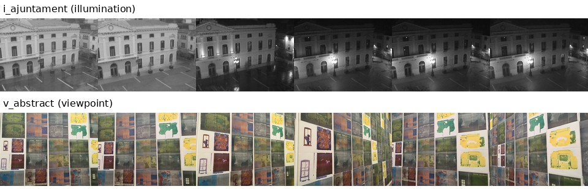
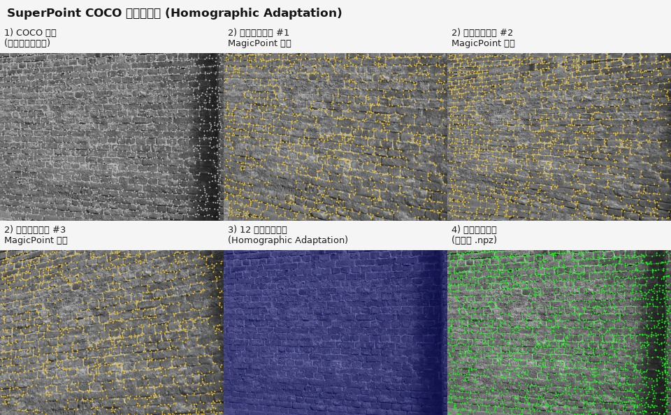

# Notebook

个人学习笔记。当前仅维护本文件；后续会跨 workspace 补充各模块内容。

## Contents

- [硬件平台](#硬件平台)
- [深度学习基础知识](#深度学习基础知识)
- [特征点提取和匹配](#特征点提取和匹配)
- [VLN](#vln)
- [3D-GS](#3d-gs)
- [3D 场景图](#3d-场景图)

---

## 硬件平台

> 训练/推理所用服务器、GPU、Docker 环境与 CUDA 栈。

### 217 服务器

**宿主机**

| 项 | 值 |
|----|-----|
| 标识 | 217 服务器 |
| hostname | `shd-ai-02` |
| GPU | 2 × NVIDIA GeForce RTX 3090（24576 MiB） |
| 驱动 | 580.173.02 |
| 驱动支持的最高 CUDA（`nvidia-smi`） | 13.0 |

**Docker：`clip_lora`**

| 项 | 值 |
|----|-----|
| 镜像 | `clip_lora_saved:v1` |
| 系统 | Ubuntu 22.04.3 LTS |
| 挂载 | `/PnP` → `/PnP`；`/data` → `/workspace` |
| CUDA Toolkit（`nvcc`） | 11.8（V11.8.89） |
| PyTorch | 2.7.1+cu118 |
| PyTorch 编译 CUDA | 11.8 |
| `torch.cuda.is_available()` | True |

**说明**：容器内实际使用 **CUDA 11.8**；`nvidia-smi` 显示的 13.0 是驱动能支持的最高 CUDA 版本，不是容器内安装的版本。

**常用命令**

- 启动：`docker start clip_lora`
- 进入：`docker exec -it clip_lora bash`
- 查看 GPU：`nvidia-smi`
- 指定 GPU 训练：`CUDA_VISIBLE_DEVICES=0 python train.py`

### 笔记

> **来源** · 2026-08-27 · 217 服务器 clip_lora CUDA 环境 · chat: `61019486-efeb-40eb-9c0b-ba2bea826b48` · workspace: `maoli`

---

## 深度学习基础知识

> 基础概念、训练流程（step/epoch、蒸馏、验证）、以 MobileNet-SP 蒸馏为实例。

### 基础概念

**Step 与 Epoch**

- **1 step** = 1 次梯度更新 = 处理 **1 个 batch**（如 batch_size=16 即 16 张图），**不是**一遍全量训练集。
- **1 epoch** ≈ 遍历训练集一次 ≈ `训练集张数 / batch_size` 个 step。
- 公式：`epoch 数 = max_steps × batch_size / 训练集张数`（例：100k×16/31970≈50 epoch）。

**知识蒸馏（稠密监督）**

- Teacher（冻结）对 **clean 图** 产出稠密 target；Student 对输入（可增强）产出预测。
- 在 `H/8 × W/8` 特征图上 **逐 cell 对齐** 比较，不是整张图的单一分类 logits。
- 训练目标：Student 在退化输入上仍复现 Teacher 在理想输入上的 detector 分布与 descriptor 向量。

### 网络结构

（详见 [特征点提取和匹配 → 跨 cell 上下文](#跨-cell-上下文架构对比)；实现见 `rob_slam-research/train/mobilenet_sp/model.py`。）

### 训练与优化

**数据增强（仅 student 输入）**

- 光度增强：亮度、对比度、高斯噪声、阴影、运动模糊；顺序随机；**无几何变换**（像素空间对应不变）。
- `teacher_image` = resize 后的 clean 图；`student_image` = 增强版（同源）。
- **验证/评估**：`augment=False`，`teacher_image` 与 `student_image` 均为 clean；验证时 student forward 也用 clean（与训练不同）。

**蒸馏损失（分开定义，再组合）**

| 子损失 | 形式 | 说明 |
|--------|------|------|
| Detector | 软交叉熵 | student logits vs teacher `dense_scores`（65 维 softmax，含 dustbin） |
| Descriptor | 稠密 L2 / 2 | 单位向量时等价于 `1 - cosine` |
| 总损失 | `HFNetUncertaintyLoss` | 两项分别算标量，再用可学习 `logvar` 加权合成；detector 项额外 ×2 |

**Validation 与 checkpoint**

- 按 **route group** 固定 hold-out，非 k-fold cross validation。
- 训练时定期在 val 上算 `det_loss` / `desc_loss` / `mean_cosine` 并 **写入 checkpoint**，但 **无** 自动 `best.pth`、early stopping 或 val 驱动 LR。
- LR 按固定步数衰减（如 60k→1e-4，80k→1e-5），选最优 step 需 **人工对比** 各 `step_*.pth` 中的 `validation` 字段。

**收敛与扩数据（`distill_full_v1`，100k 步）**

- Validation（1024 张分层采样）：100k 时 det≈0.338，desc≈0.048，mean_cosine≈0.952；**75k 后进入平台期**，95k 略优于 100k。
- 加训练数据后：同样 100k 步 → 每张图被看到的 **epoch 数减少**（数据翻倍约减半）；若要保持同等覆盖需 **同比增加 max_steps**，或接受更少 epoch。
- 加 store 数据主要改善 **held-out test 泛化**；同一条 val 上的 dense 指标不一定更高，应以 test 关键点/匹配指标为准。

### 笔记

- 实现参考：`/PnP/maoli/git/rob_slam-research/train/mobilenet_sp/`（`data.py` / `losses.py` / `train.py`）。
- 归档文档：`.ai/plans/zh-CN/2026-08-26-mobilenet-sp-distill-onnx.md`。
- 远程 Agent 笔记本路径：`/PnP/maoli/git/notebook/note_server.md`（须放在服务器可写路径，非本机独占目录）。

> **来源** · 2026-08-27 · MobileNet-SP 蒸馏训练基础 · chat: `d1cc100e-0665-49ab-aca9-c4cf9d92fe9f` · workspace: `maoli`

---

## 特征点提取和匹配

> 检测器、描述子、匹配策略、几何验证；以 SuperPoint 权重生态为入口。

### 检测与描述

**SuperPoint 没有官方 v1–v6 产品线。** 社区里常说的版本主要是两套预训练权重；v2–v5 多为 rpautrat 训练实验/合成数据集后缀，不是公开发布的独立架构。

| | **v1** | **v6** |
|--|--------|--------|
| 来源 | MagicLeap 论文作者推理权重 | rpautrat TensorFlow 复现后转 PyTorch |
| 权重 | `superpoint_v1.pth` | `superpoint_v6_from_tf.pth`（另有 `sp_v6.tgz` TF SavedModel） |
| 许可 | MagicLeap 专有 | MIT |
| 典型用途 | LightGlue / SuperGlue / ONNX / C++ 部署 | 自监督复现、蒸馏 teacher（早期） |

**架构相同、实现不同**（均为 VGG 风格 encoder + detector/descriptor 双头，65 通道 detector、256 维描述子、stride 8）：

| 特性 | v1 | v6 |
|------|----|----|
| BatchNorm | 无 | 有（`VGGBlock` 内 BN） |
| 卷积组织 | `conv1a/conv1b/...` | `backbone` + `detector`/`descriptor` |
| 描述子采样 | `kp - s/2 + 0.5`，`align_corners=True` | `(kp+0.5)/(hw*stride)`，`align_corners=False` |
| 默认检测阈值 | 0.0005（LightGlue）；部署 YAML 常再调到 0.05/0.1 | 0.005 |

**不可互换**：v1 权重不能加载到 v6 模型定义，反之亦然。

**HPatches（rpautrat README）**：v6 光照 repeatability 与光照 homography 更好；v1 视角变化下描述子略强。

**v2–v5 含义**：`synthetic_shapes_v6` 等是数据生成配置版本（如 blur/resize/homographic aug）；`mp_synth-v6/v10/v11` 是 MagicPoint 自监督迭代实验名（HA 轮次），不是独立公开 checkpoint。

**部署注意**：SPSG ONNX 图只出 dense `scores`/`descriptors`；C++ 侧 `normalize_keypoints` 已是 **v1 采样公式**。训练 teacher 与后处理约定不一致会导致匹配变差。

本地路径：`tiny_point/SuperPoint/weights/`；论文 [DeTone et al., 2018](https://arxiv.org/abs/1712.07629)；实现 [MagicLeap](https://github.com/MagicLeapResearch/SuperPointPretrainedNetwork)、[rpautrat](https://github.com/rpautrat/SuperPoint)。

> **来源** · 2026-08-27 · SuperPoint v1 与 v6 差异 · chat: `42d2be9d-5210-422d-8e7c-b7b6cb434b35` · workspace: `maoli`

### 跨 cell 上下文（架构对比）

**「跨 cell 上下文」指什么**

- stride-8 网格上，每个 cell 的 detector 决策是否利用了**邻域 cell / 更大感受野**的语义，而不只是本 cell 内 8×8 像素的局部信息。
- SuperPoint / MobileNetSP 的 **65 类 softmax 是 per-cell 的**（64 子像素 + dustbin），softmax 本身不跨 cell；跨 cell 能力来自 **共享深层特征 + head 上的空间卷积**。
- NMS 是 decode 后的后处理，提供跨关键点抑制，**不参与训练稠密 target**，也不能补回 detector 没学到的跨 cell 一致性。

**SuperPoint v1 detector**

```
图像 → 共享 encoder（conv1–4，stride 8）→ convPa(3×3) → convPb(1×1) → 每 cell 65 类 softmax
              ↑                                    ↑
        跨 cell 深层语义                      显式混邻域 cell
```

- 每个 cell 的 65 类分布由 **大感受野共享特征 + 3×3 head** 决定，邻域角点/边缘信息会进入当前 cell 的 logits。

**MobileNetSP（蒸馏 student）**

```
图像 → HFNetLocalBackbone（stride 8）→ detector_head(3×3+1×1) / descriptor_head(3×3+1×1)
              ↑
    与 SuperPoint 同构：共享 backbone + 3×3 head，有跨 cell 上下文
```

- 有跨 cell 能力，但 depthwise separable + 更小通道（96 vs 128）→ 每层混合弱于 SuperPoint 全卷积，不保证达到 teacher 的 viewpoint repeatability 上限。
- 蒸馏损失逐 cell 独立（detector 软 CE + descriptor 稠密 L2），跨 cell 行为靠卷积感受野隐式学习。

**XFeat detector（关键差异）**

XFeat **也有 cell 结构**（输出 `[B,65,H/8,W/8]`，decode 后 pixel_shuffle 到全分辨率），但 **keypoint 分支不接 backbone**：

```
图像 ──► block1–5 + fusion ──► feats / heatmap（描述子、可靠性）  ← 有跨 cell
  │
  └──► _unfold2d(原图, ws=8) ──► keypoint_head（全 1×1 卷积）──► 65 类
                              ↑
                    每 cell 仅 64 个原图像素 channel，无跨 cell
```

| 维度 | SuperPoint | MobileNetSP | XFeat keypoint_head |
|------|------------|-------------|---------------------|
| detector 输入 | 共享深层特征 | 共享 backbone 特征 | unfold 后的原图像素 |
| head 空间卷积 | 3×3 + 1×1 | 3×3 + 1×1 | 仅 1×1 |
| 跨 cell 上下文 | 有 | 有（可能弱于 SP） | **几乎没有** |
| 描述子分支 | 共享 encoder | 共享 backbone | 独立深 CNN（有跨 cell） |

- XFeat 的 CNN **服务于描述子**，detector 被 architecturally bypass；`keypoint_head` 在每个 stride-8 位置等价于「64 像素 → 65 类」的小 MLP。
- 实践中可能表现为 **点更多 / 更噪**：相邻 cell 各自独立响应，cell 边界附近易产生 competing peaks；NMS 只能事后抑制，不能替代训练阶段的跨 cell 一致性。
- 即使训练流程正确，XFeat detector 在架构上对 **viewpoint repeatability** 存在上限；MobileNetSP 因共享 backbone + 3×3 head，在这方面更接近 SuperPoint。

**代码参考**

- SuperPoint v1：`rob_slam-research/dependencies/internal/superpoint-superglue/convert2onnx/superpoint.py`
- MobileNetSP：`rob_slam-research/train/mobilenet_sp/model.py`
- XFeat：`tiny_point/accelerated_features/modules/model.py`（`keypoint_head` + `_unfold2d`）

> **来源** · 2026-08-30 · 跨 cell 上下文架构对比（SuperPoint / MobileNetSP / XFeat）· workspace: `maoli`

### HPatches 数据集

**定位**：标准 benchmark，**不参与 SuperPoint 训练**，只用于评估检测器/描述子。

**本地路径**：`/PnP/maoli/tiny_point/datasets/hpatches-sequences-release`（1.8 GB，116 序列：57 个光照 `i_*` + 59 个视角 `v_*`）。`eval_hpatches.py` 中 `HPATCHES_ROOT` 默认指向该目录。

**目录结构**（每个序列 6 张图 + 单应矩阵）：

```
hpatches-sequences-release/
├── i_ajuntament/          # 光照变化
│   ├── 1.ppm ... 6.ppm    # 参考图为 1.ppm
│   ├── H_1_2 ... H_1_6    # 图1 → 图2~6 的单应矩阵
│   └── attribs.txt
├── v_abstract/            # 视角变化
└── ...
```

- **`i_*`**：同一场景，光照/曝光变化（`H` 接近单位阵）
- **`v_*`**：同一场景，相机视角/位置变化（`H` 有明显变换）
- 图像格式 **PPM**，分辨率 **640×480**

**图像示例**（上排光照 `i_ajuntament`，下排视角 `v_abstract`，各 6 张）：



**评估方式**（以图 1 为参考，分别与图 2~6 配对）：

| 指标 | 测什么 | 简要流程 |
|------|--------|----------|
| **Repeatability** | 检测器 | 两图各检测点 → 用 `H_1_i` 把图1点搬到图 i → 统计 3px 内能对上的比例 |
| **Homography accuracy / MMA** | 描述子 | 描述子匹配 → RANSAC 估 `H_est` → 与 GT `H_1_i` 比 corner error |

v6（rpautrat）README 步骤 4/7 即上述流程；v1（MagicLeap）**无训练/评估代码**，但论文实验部分有介绍 HPatches 评估方法。

### COCO 伪标签（Homographic Adaptation）

**问题**：COCO 没有人工关键点标注，SuperPoint 用 **Homographic Adaptation（HA，单应自适应）** 自动生成伪标签。

**核心思路**：对每张 COCO 图做多次随机单应变换，每次用已训练的 MagicPoint 检测，把结果**反投影回原图并累加**，阈值化后得到稳定关键点。

**导出流程**（`export_detections.py`，配置 `homography_adaptation.num: 100`）：

```
COCO 原图
  ├─ 随机单应 #1 → MagicPoint 检测 → 反投影回原图
  ├─ 随机单应 #2 → ...
  └─ 随机单应 #100 → ...
        ↓ 累加概率图 → 阈值
  保存 COCO12345.npz（points: N×2）
```

**训练时用法**（`coco.py`）：读取 `.npz` 的 `points` → 转成 `keypoint_map`（稀疏 0/1 监督图）；训练增强时再随机单应变换，**标签坐标随 H 一起变换**（`warp_points`）。

**图像示例**（演示用 12 次 HA，正式导出为 100 次；单次检测 ~1870 点，聚合后 ~3032 点）：



| 面板 | 含义 |
|------|------|
| ① 原图 | COCO 图，尚无标签 |
| ② 随机变换 | 扭曲后 MagicPoint 检测（黄点） |
| ③ 累加热力图 | 多次反投影叠加（HA） |
| ④ 伪标签 | 阈值后的关键点（绿点）→ 存 `.npz` |
| ⑤ 训练增强 | 训练时再随机变换，标签随 H 走 |
| ⑥ 导出格式 | 每张 COCO 图对应一个 `xxx.npz` |

**SuperPoint 完整训练数据流**：

```
Synthetic Shapes → MagicPoint（学会找角点）
       ↓
COCO + HA 导出伪标签 → MagicPoint on COCO（适应真实图）
       ↓
再导出伪标签 → SuperPoint 联合训练（检测 + 描述子）
       ↓
HPatches 评估（repeatability / homography accuracy）
```

**代码参考**：`tiny_point/SuperPoint/superpoint/models/homographies.py`（`homography_adaptation`）、`superpoint/datasets/coco.py`、`configs/magic-point_coco_export.yaml`。

> **来源** · 2026-08-28 · HPatches 与 COCO 伪标签 · chat: `bb3d28ad-215c-4e6e-82b4-ec5fce853847` · workspace: `maoli`

### 匹配与几何验证

### 笔记

---

## VLN

Vision-Language Navigation。

> 待补充：任务定义、数据集、代表性方法、评测指标。

### 任务与设定

### 方法

### 笔记

---

## 3D-GS

3D Gaussian Splatting。

> 待补充：表示与渲染、训练流程、变体与应用。

### 表示与渲染

### 训练

### 笔记

---

## 3D 场景图

> 3D 场景图表示、跨模态对齐与房间检索；以 VLSG（Visual-Language Scene Graph Alignment）复现为主线。

### 任务与数据

**VLSG 任务**：跨模态 **3D 房间检索** — 给定查询 RGB 序列（来自未知房间的 rescan），在参考场景库中检索最匹配的 reference scan。

**3RScan 中的 scan**

- 一个 scan = 对某房间 **某一次** RGB-D 扫描记录，不等于「房间」本身；同一物理房间可有多次 scan（reference + 多个 rescan）。
- **Reference scan**：参考场景库条目，含 mesh、标注 PLY、`sequence/`（RGB-D 帧）。
- **Rescan (Query)**：重扫描，推理时作为查询输入，需匹配到正确的 reference。

**推理所需数据**（不必下载全量 train）

- `val_resplit` / `test_resplit` 对应 scan 及 rescan、`sequence.zip` 解压后的帧序列。
- 3DSSG 场景图标注、`meta.zip`（相机内参等）。
- 预训练权重：`output/train/pretrained_3rscan.pth`。

### VLSG 架构与数据流

**两大模块**

| 模块 | 时机 | 输入 | 产出 |
|------|------|------|------|
| **查询端 (Query)** | 在线 | Rescan RGB 帧 | `Features2D/` patch 特征 |
| **参考场景库 (Reference DB)** | 离线预构建 | PLY+JSON、参考扫描 RGB | `scene_graph/`、`Features3D/`、`patch_anno/` |

**特征两路**

- **2D**：DINOv2-ViT-G/14，整帧 resize 1024×576 → 每帧 144 patch × 1536 维；**无需** bbox/点云，仅需 RGB。
- **3D 物体视觉**：同一 DINOv2；依赖 GT 2D 投影确定物体可见帧，Top-10 帧 + 多层级 bbox crop，聚合为 per-object 特征。

**推理**：`Features2D + Features3D + patch_anno + scene_graph` + 预训练模型 → Patch-Object 对齐 + GAT 场景图编码 → 房间检索排名。

**mmdet / mmcv**：主要用于 GCVit backbone 注册与 checkpoint 加载；推理配置 `use_feature: True` 时不走检测前向，但 import 链仍需兼容 mmcv 2.x / mmdet 3.x。

### 复现与环境

- **环境**：Docker `clip_lora`，Conda `VLSG`（`/opt/conda/envs/VLSG`），Python 3.8，PyTorch 2.1+cu118，mmcv 2.1.0，mmdet 3.3.0。
- **工作目录**：`/PnP/maoli/VLSG`，数据 `/PnP/maoli/data/3RScan`。
- **预处理顺序**：对齐 PLY → `preprocess_scan3r.py`（scene_graph）→ GT 2D 投影 → patch 标注 → 2D DINOv2 特征 → 3D 物体 DINOv2 特征。
- **推理**：`bash scripts/train_val/inference.sh val` / `test`；入口 `src/room_retrieval/patch_SGIE_aligner/inference_room.py`。
- **完整文档**：`/PnP/maoli/REPRODUCTION_GUIDE.md`。

**常见坑**

- DINOv2 在 Python 3.8 需 `from __future__ import annotations`（torch hub 缓存内 attention.py）。
- mmcv 1.x API → mmengine / mmdet.registry；`scan3r_objpair_XTAE_SGI.py` 对缺失特征文件用空占位 `{'obj_visual_emb': {}, 'obj_image_votes_topK': {}}`。
- 部分 test scan 无 `sequence/`，时序 R@1 偏低属预期；Non-Temporal 指标仍正常。

### 评测与可视化

**Val 关键指标**（与论文一致）

- R@1 (Temporal-Sequential)：87.8%；R@1 (Non-Temporal)：90.9%；Patch R@1：73.7%。

**输出目录** `output/inference/`

- 数值：`val_result.txt`、`val_temp_statistics/val_retrieval_statistics.txt`
- 图表：混淆矩阵、检索成功率 vs 时间步、Shannon 熵分析（PNG）
- 检索记录：`retrieval_record_val.pkl` — 每 query scan 含 `frames_retrieval`、`room_score_scans_T/NT`、`temporal_scan_id`（GT）

**定性查看**

- PLY：`labels.instances.annotated.v2.ply`（带实例颜色，可用 maplab 打开）。
- 示例包：`/PnP/maoli/retrieval_examples/`（query 帧 + Top-1 PLY + README）；流程图 `VLSG_pipeline.png`，检索拼图 `VLSG_retrieval_vis.png`。

### 笔记

- 代码仓库：`git@github.com:y9miao/VLSG.git`（本地 `/PnP/maoli/VLSG`）。
- Point-NN 子模块：`thrid_party/Point-NN`，需 `pip install -e pointnet2_ops_lib`。
- 容器内文件拷到宿主机：`docker cp clip_lora:/path/in/container /tmp/...`（勿用 `docker exec cp` 到容器内 `/tmp` 误以为在宿主机）。

> **来源** · 2026-08-27 · VLSG 推理复现与可视化 · chat: `31e39936-4d25-498c-a9fc-a3c51eaa281d` · workspace: `maoli`
